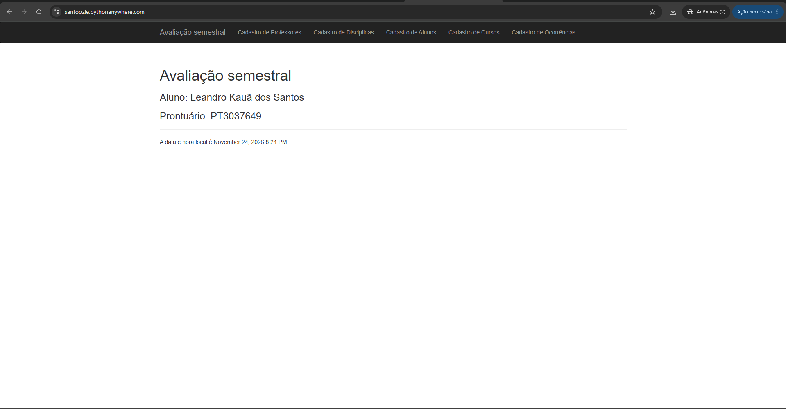

# Avaliação semestral — Cadastro de Cursos (Flask)

**Aluno:** Leandro Kauã dos Santos — **Prontuário:** PT3037649  
**Disciplina:** Desenvolvimento de Sistemas Web — IFSP  
**Aplicação publicada:** https://santoozle.pythonanywhere.com

## Recursos utilizados
- Hospedagem no PythonAnywhere e versionamento no GitHub
- Rotas: `/` (principal) e `/cursos` (Cadastro de Cursos)
- Tratamento de erros: 404 exibe a página **"Não disponível"** (módulos não desenvolvidos: Professores, Disciplinas, Alunos e Ocorrências, que não têm rota) e 500 exibe uma página de erro
- Templates Jinja2 com herança (`base.html` → páginas)
- Flask-Bootstrap (navbar e `wtf.quick_form`)
- Flask-Moment (data e hora local do navegador)
- Flask-WTF (formulário de cadastro com validação e CSRF)
- Flask-SQLAlchemy + SQLite (gravação e listagem dos cursos)

## Executar localmente
```bash
python -m venv venv
venv\Scripts\activate        # Windows  (Linux/Mac: source venv/bin/activate)
pip install -r requirements.txt
flask --app flask_app run
```

## Tela inicial

